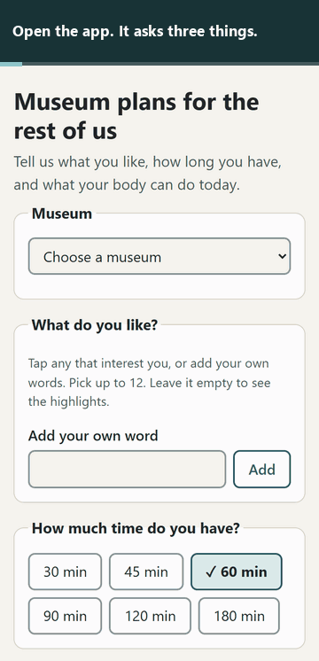

# Museum plans for the rest of us

[](https://github.com/karthikvalluri85/museum-planner/actions/workflows/ci.yml)

## How to use it



1. **Pick a museum.**
2. **Tap what you like,** or type your own words.
3. **Say how long you have.**
4. **Say what your body needs today:** step-free, limited stamina, with a young child, low sensory, or a short visit.
5. **Tap "Build my plan".** You get an ordered route: each stop with its gallery number, one sentence on why it was picked, the minutes to spend there, and the minutes to walk to the next, naming any elevator on the way.
6. **Plans change.** Tap "I'm here" on the stop you have reached, then "Running late" or "Skip this wing", and the rest of the visit is rebuilt from where you are standing.

The plan says "step-free" only when every connection on the route is marked step-free, and it tells you what each of your choices did. The recording shows the app running on the Metropolitan Museum of Art's open-access data.

Museums are built for a visitor with three free hours, two good legs, no kids, and no sensory issues. Most people are not that visitor. This app builds a visit plan from what you like, how long you have, and what your body can do today.

Built for the Product Hunt x Google Cloud Run "Build for Good" contest.

**Status: built, deployed to Google Cloud Run on 13 November 2026, verified with real requests, and taken offline on 14 November 2026.** Nothing was deleted, so it can be brought back in two commands; see [docs/HANDOVER_CREDENTIALS.md](docs/HANDOVER_CREDENTIALS.md). Both test suites and the offline integration audit pass locally and in CI. Never run: `docker-compose.yml` and the deploy workflow.

## Layout

| Path | What it is |
|---|---|
| `contracts/` | Every interface, defined before the code: planner OpenAPI, Firestore documents, the Pub/Sub message, the museum APIs we depend on, and the service catalog (env, IAM, scaling). Start with `contracts/README.md`. |
| `services/ingestion-job/` | Cloud Run job. Pulls a museum's open API, normalizes, writes Firestore. Bundles the hand-built floor graphs and raw fixtures. |
| `services/planner/` | Cloud Run service. Scores and routes a plan. Serves the web frontend from `static/`. |
| `tools/` | Zero-dependency Node tooling: contract gate, floor-graph checks, plan checker, mock planner, offline integration audit. |
| `deploy/` | Parameterized deploy, verify, and add-museum scripts. |
| `docs/` | Architecture (generated from the contracts), floor-graph provenance, handover checklist. |
| `launch/` | Product Hunt deliverables. |
| `DECISIONS.md` | One line per architectural decision and why. |

The two services share no code. They agree only through `contracts/`.

## Contract gate and frontend preview (Node only)

```bash
node tools/selftest.mjs
```

```bash
node tools/validate-contracts.mjs
```

```bash
node tools/validate-contracts.mjs --graph services/ingestion-job/seed/floor_graphs/met.json
```

Preview the frontend against a mock that answers with the contract's example responses:

```bash
node tools/mock-planner.mjs 8099
```

Then open http://localhost:8099. The mock does not plan anything; type `nostepfree` or `nothing` as an interest to see the other two response shapes.

## Run the real thing

Needs Python 3.12 or Docker. See step 0 of [docs/HANDOVER_CREDENTIALS.md](docs/HANDOVER_CREDENTIALS.md). With Python, the offline audit ingests the fixtures into a file-backed store, serves them with the planner, and checks real responses against the contract:

```bash
PYTHON="$(pwd)/.venv/Scripts/python" bash tools/integration-audit.sh
```

With Docker (not yet run anywhere):

```bash
docker compose up --build
```

A 45-minute step-free plan with curl, once the planner is up:

```bash
curl -s -X POST http://localhost:8080/api/plan -H "content-type: application/json" -d "{\"museum_id\":\"met\",\"interests\":[\"egyptian art\"],\"time_budget_minutes\":45,\"constraints\":{\"step_free\":true}}"
```

## Guardrails

1. A route is never called step-free unless every edge on it is marked step-free in the floor graph. If none exists, the app says so and names the stairs the best alternative needs.
2. Gallery numbers are never invented. An object the museum's data does not place in a gallery cannot be planned.
3. Every "why" sentence is assembled from the object's own tags and fields.
4. Every plan says it is built from public data and that the museum has not reviewed it.

Where each is enforced: [docs/ARCHITECTURE.md](docs/ARCHITECTURE.md#product-guardrails-and-where-each-is-enforced).

## Contributing

See [CONTRIBUTING.md](CONTRIBUTING.md). The most useful contribution is a correction to a floor map: [report one here](https://github.com/karthikvalluri85/museum-planner/issues/new?template=floor-data-error.yml). Security and privacy reports go through [SECURITY.md](SECURITY.md).

## License

The code is under the [MIT License](LICENSE). The bundled museum records are not ours and have their own terms; see `services/ingestion-job/fixtures/README.md`. The floor maps in `services/ingestion-job/seed/floor_graphs/` are our own work, built from the museums' published plans, and are covered by the same license.

## Honest limits

- The floor graphs (which galleries connect, where elevators and stairs are) are hand-built per museum and have not been verified on site.
- A new museum needs an adapter for its API and a floor graph in the ingestion image. Publishing its id then ingests it with no redeploy.
- Routing is greedy, not optimal.
