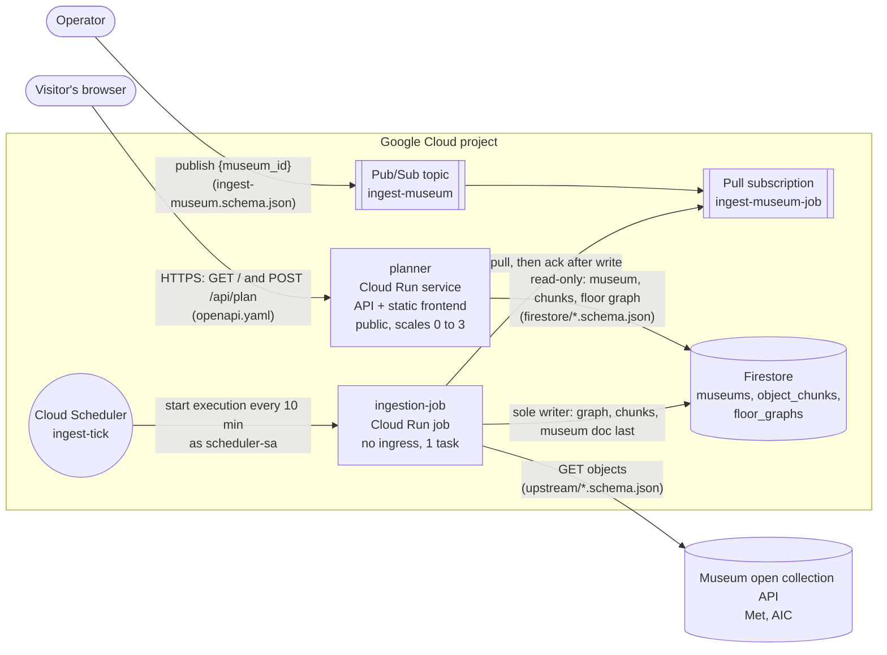
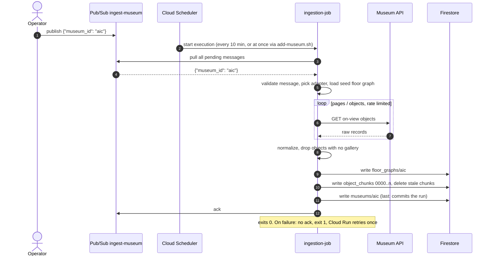
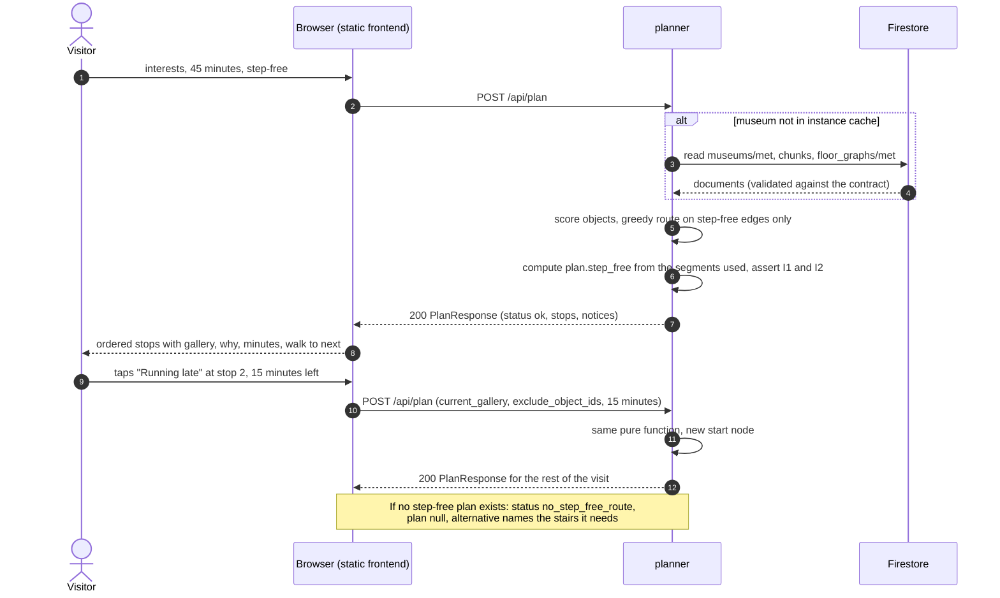

# Architecture

A web app that builds a museum visit plan from three things a visitor tells it: what they are interested in, how much time they have, and what their body can do that day.

This document is tied to `/contracts`. The sections between `GENERATED` markers are rendered from the contracts and from `docs/decisions.json` by `node tools/gen-architecture.mjs`; `node tools/validate-contracts.mjs` fails if they are stale. Everything else is hand-written.

**Status: deployed to Cloud Run on 2026-11-13 and verified with real requests; taken offline on 2026-11-14 (public access removed, timer paused, nothing deleted).** See [HANDOVER_CREDENTIALS.md](HANDOVER_CREDENTIALS.md).

## The five pieces

1. **Museum open collection API** (the Met, the Art Institute of Chicago). Not ours.
2. **`ingestion-job`**, a Cloud Run job. Pulls a museum's API, normalizes every object into one schema, writes Firestore.
3. **Firestore**. Normalized objects and the hand-built floor graphs.
4. **`planner`**, a Cloud Run service. Scores and routes a plan; also serves the web frontend.
5. **Pub/Sub** topic `ingest-museum`. Publishing a museum id is how a museum is added. No redeploy.

Cloud Scheduler is the clock that starts the job; it holds no logic.

## Topology

## Sequence: adding a museum

## Sequence: a plan, then "running late"

## Service catalog

<!-- GENERATED:service-catalog -->
| Deployable | Kind | Provides | Consumes | Scaling bounds | Failure and retry policy |
|---|---|---|---|---|---|
| `planner` (`services/planner`) | Cloud Run service | [`planner/openapi.yaml`](../contracts/planner/openapi.yaml) | [`firestore/museum.schema.json`](../contracts/firestore/museum.schema.json) [`firestore/object-chunk.schema.json`](../contracts/firestore/object-chunk.schema.json) [`firestore/floor-graph.schema.json`](../contracts/firestore/floor-graph.schema.json) | min 0, max 3 instances; concurrency 40; 1 CPU, 512Mi; timeout 30s | No retries server-side: every request is idempotent, the browser retries. Firestore read failure returns 503 store_unavailable. A museum's objects and graph are cached in memory for CACHE_TTL_SECONDS. |
| `ingestion-job` (`services/ingestion-job`) | Cloud Run job | [`firestore/museum.schema.json`](../contracts/firestore/museum.schema.json) [`firestore/object.schema.json`](../contracts/firestore/object.schema.json) [`firestore/object-chunk.schema.json`](../contracts/firestore/object-chunk.schema.json) [`firestore/floor-graph.schema.json`](../contracts/firestore/floor-graph.schema.json) | [`events/ingest-museum.schema.json`](../contracts/events/ingest-museum.schema.json) [`upstream/met-object.schema.json`](../contracts/upstream/met-object.schema.json) [`upstream/aic-artwork.schema.json`](../contracts/upstream/aic-artwork.schema.json) | 1 task, parallelism 1; 1 CPU, 512Mi; task timeout 1800s; max retries 1 | A message is acked only after its museum is fully written. Invalid messages are logged and acked so they cannot poison the queue. Any museum failure makes the job exit non-zero; Cloud Run retries the task once and unacked messages are redelivered. The museum document is written last, so a failed run never points readers at half-written chunks. |
<!-- /GENERATED:service-catalog -->

## HTTP API

<!-- GENERATED:http-api -->
Contract version 1.0.0 (OpenAPI 3.1.0).

| Operation | operationId | What it does | Responses |
|---|---|---|---|
| `GET /health` | `getHealth` | Liveness probe. Does not touch Firestore. | 200 |
| `GET /api/museums` | `listMuseums` | Museums that have been ingested and have a floor graph. | 200, 503 |
| `GET /api/museums/{museum_id}` | `getMuseum` | One museum with interest facets, wings, and floor-data provenance. | 200, 404, 503 |
| `POST /api/plan` | `createPlan` | Build a plan, or rebuild the rest of one from the current gallery. | 200, 404, 422, 500, 503 |
<!-- /GENERATED:http-api -->

## Backing resources

<!-- GENERATED:resources -->
| Resource | Kind | Contract | Notes |
|---|---|---|---|
| `ingest-museum` | pubsub-topic | [`events/ingest-museum.schema.json`](../contracts/events/ingest-museum.schema.json) | Publishing a message that names a museum id adds or refreshes that museum. No redeploy. |
| `ingest-museum-job` | pubsub-subscription | [`events/ingest-museum.schema.json`](../contracts/events/ingest-museum.schema.json) | Pull subscription on ingest-museum, ack deadline 600s, drained by ingestion-job at the start of every execution. |
| `(default)` | firestore-database | [`firestore/museum.schema.json`](../contracts/firestore/museum.schema.json) | Native mode. Collections: museums/{id}, museums/{id}/object_chunks/{nnnn}, floor_graphs/{id}. ingestion-job is the only writer; planner only reads. |
| `ingest-tick` | cloud-scheduler-job | none | Every 10 minutes, starts an ingestion-job execution as scheduler-sa. An execution with nothing to do exits in seconds. |
<!-- /GENERATED:resources -->

## Environment, secrets, and IAM

There are no secrets: the museum APIs need no keys and the planner is public. Service-to-service permissions are below. The planner cannot write to Firestore and cannot be asked to ingest; the job cannot be reached from the internet.

<!-- GENERATED:env-iam -->
### `planner`

Ingress: `all`. Auth: `allow-unauthenticated`. Runs as `planner-sa` with `roles/datastore.viewer`. May be invoked by: `allUsers`. Secrets: none.

| Variable | Required | Default | Purpose |
|---|---|---|---|
| `PORT` | no | `8080` | Injected by Cloud Run. |
| `STORE_BACKEND` | no | `firestore` | firestore or file. file is for offline tests only. |
| `GOOGLE_CLOUD_PROJECT` | yes |  | Project that owns the Firestore database. Required when STORE_BACKEND=firestore. |
| `FIRESTORE_DATABASE` | no | `(default)` | Firestore database id. |
| `FIRESTORE_EMULATOR_HOST` | no |  | Local only. Points the client at the emulator. |
| `FILE_STORE_DIR` | no |  | Local only. Directory read when STORE_BACKEND=file. |
| `CACHE_TTL_SECONDS` | no | `600` | How long an instance keeps a museum in memory. |

### `ingestion-job`

Ingress: `none`. Auth: `iam`. Runs as `ingestion-sa` with `roles/datastore.user`, `roles/pubsub.subscriber`. May be invoked by: `serviceAccount:scheduler-sa`. Secrets: none.

| Variable | Required | Default | Purpose |
|---|---|---|---|
| `STORE_BACKEND` | no | `firestore` | firestore or file. file is for offline tests only. |
| `GOOGLE_CLOUD_PROJECT` | yes |  | Project that owns Firestore and Pub/Sub. Required unless STORE_BACKEND=file and MUSEUM_ID is set. |
| `FIRESTORE_DATABASE` | no | `(default)` | Firestore database id. |
| `PUBSUB_SUBSCRIPTION` | no | `ingest-museum-job` | Pull subscription on topic ingest-museum. |
| `MUSEUM_ID` | no |  | If set, ingest only this museum and do not touch Pub/Sub. |
| `SOURCE_MODE` | no | `live` | live calls the museum API. fixture reads bundled raw payloads. |
| `MAX_OBJECTS` | no | `1500` | Cap on plannable objects written per museum. |
| `REFRESH_AFTER_HOURS` | no | `168` | Museums ingested longer ago than this are refreshed on any run. 0 disables. |
| `FIRESTORE_EMULATOR_HOST` | no |  | Local only. |
| `PUBSUB_EMULATOR_HOST` | no |  | Local only. |
| `FILE_STORE_DIR` | no |  | Local only. Directory written when STORE_BACKEND=file. |
<!-- /GENERATED:env-iam -->

`scheduler-sa` holds only `roles/run.invoker` on `ingestion-job`. Whoever adds a museum needs `roles/pubsub.publisher` on the topic.

## Architecture decision record

<!-- GENERATED:decisions -->
| # | Decision | What we chose | Why | Status |
|---|---|---|---|---|
| D01 | Ingestion is a Cloud Run job, not a service | The ingester runs to completion and exits; it listens on no port. | Pulling a museum's API is a batch with a beginning and an end. A job is billed only while it works and cannot be reached from the internet at all. | decided |
| D02 | The planner is stateless | A plan is a pure function of the request and the stored museum. Replanning is another POST /api/plan carrying the current gallery, the objects already seen, and the wings to skip; the browser holds that state. | No sessions means no session store, instances can scale to zero between visits, and any instance can answer any request. | decided |
| D03 | The planner serves the web frontend | Static files ship inside the planner image and are served from /. | One deployable and one URL for the demo. Same origin, so no CORS. A separate frontend service would add a deploy step and nothing else. | decided |
| D04 | Firestore is the only shared state, behind a schema contract | ingestion-job is the sole writer and planner has read-only IAM. The document shapes are contracts in contracts/firestore, and each side validates them with its own models. | The brief fixes the system at five pieces, so there is no data-API service between the two deployables. Treating the documents as a versioned contract with one writer gives the same decoupling without a sixth piece. | decided |
| D05 | Pub/Sub is pulled by the job; Cloud Scheduler starts the job | Publishing {museum_id} to topic ingest-museum queues a museum. The job drains the pull subscription at the start of every execution. A Scheduler tick starts an execution every 10 minutes; deploy/add-museum.sh publishes and starts one immediately. | Pub/Sub push cannot start a Cloud Run job directly, and the usual bridge (Eventarc plus Workflows) would add two pieces. Pull-and-drain keeps the job a job and keeps adding a museum to one publish, at the cost of up to 10 minutes of delay. | assumption |
| D06 | Objects are stored in chunk documents | Up to 250 normalized objects per Firestore document under museums/{id}/object_chunks. | A planner cold start loads a whole museum. One document per object would cost about 1,500 reads per cold start and leave the free tier on launch day; chunks cost about 6. | decided |
| D07 | The museum document is written last | An ingest run writes the floor graph, then the chunks, then deletes stale chunks, then the museum document, whose chunk_count is the pointer readers trust. | A run that fails halfway never leaves readers pointing at half-written data, without needing a transaction across hundreds of kilobytes. | decided |
| D08 | Objects without a gallery are dropped at ingestion | The object schema requires a non-empty gallery, so an object the museum's API does not place in a gallery never reaches Firestore. | Never invent gallery numbers. Enforcing it at the data boundary means the planner cannot plan such an object even by mistake. | decided |
| D09 | The floor graph is hand-built, coarse, and says how far it has been verified | One JSON graph per museum, bundled in the ingestion image. A node is a run of adjacent galleries on one level. The graph carries a verification status that every plan repeats in its notices. | No collection API describes which galleries connect or where the elevators are. A coarse graph can be built by hand in a day; saying plainly that it is unverified is the honest way to ship it. | decided |
| D10 | Unknown means not step-free | An edge is step_free only when the published plan supports it. A connection we are unsure about is marked not step-free and given a name. | Wrongly saying no step-free route exists costs a visitor a suggestion. Wrongly saying one exists can strand them at a staircase. | decided |
| D11 | plan.step_free is computed, never echoed | The planner derives step_free from the segments the plan actually uses and asserts invariants I1 and I2 before responding; on failure it returns an error rather than a plan. | The claim a wheelchair user relies on must not depend on the request flag being threaded through correctly. | decided |
| D12 | Greedy scoring and routing | Score objects by interest and tag overlap weighted by the constraint profile, then repeatedly take the best feasible stop from the current position using shortest paths on the graph. | Good enough beats optimal for a visit of a dozen stops, it is easy to explain, and it is deterministic, so replanning never surprises. | decided |
| D13 | Why-sentences come from templates, not a language model | Each sentence is assembled from the object's own tags and fields, and the response lists which fields were used. | Every claim must be grounded in the museum's data. Templates cannot hallucinate, cost nothing, and add no dependency. | decided |
| D14 | Services share contracts, not code | Each deployable has its own models and tests them against /contracts. Nothing is imported across services. | Either side can be rewritten or redeployed alone, and `gcloud run deploy --source` uploads one directory at a time anyway. | decided |
| D15 | A file-backed store for offline tests | Both deployables accept STORE_BACKEND=file, which reads and writes the same documents as JSON files in the Firestore layout. | The whole pipeline (ingest a fixture, then plan from it) can be tested with nothing but Python: no emulator, no Java, no Docker, no GCP. | decided |
| D16 | Contract tooling has zero dependencies | tools/*.mjs validates the contracts, the floor graphs, and planner responses using only Node's standard library, including a small parser for the YAML subset the OpenAPI file uses. CI also runs openapi-spec-validator as an independent check. | The gate has to run on a machine where nothing can be installed. It tests itself (tools/selftest.mjs) so a green result means something. | decided |
| D17 | The planner is public and stores nothing about visitors | Unauthenticated ingress, no accounts, no cookies, no request bodies logged, no secrets. | What a visitor's body can do is sensitive. The simplest way to protect it is never to keep it. | decided |
| D18 | Hard caps on scale | Planner: 0 to 3 instances, concurrency 40. Job: one task, one retry, 30-minute timeout, 1,500 objects per museum. | A launch-day spike can slow the app down but cannot produce a surprising bill. | assumption |
| D19 | Art Institute of Chicago is the second museum | The second adapter targets the AIC API. | Its records carry a gallery title for works on view, which is the one field planning needs. Adding it shows the pipeline is not hardcoded to the Met. | assumption |
| D20 | Python 3.12 and FastAPI, as specified | No change of stack was proposed. | The brief's stack fits: the work is I/O and data shaping, the Google client libraries are first-class, and Pydantic gives runtime validation of every contract. | decided |
| D22 | A museum whose API cuts each run short is collected a batch at a time | For such a museum the job reads back what it has stored, asks the API only for objects it lacks, and writes the merged set. The museum document says whether collection is complete, and the Scheduler tick keeps going until it is. | The Met's API refuses a client after about 40 object requests, at any speed we tried. Asking for a little every 10 minutes is slower but gentler on their service than retrying, and it turns the timer from a formality into the thing that fills the museum. | decided |
| D21 | Local-first, deploy later | Everything is built and tested offline; deployment is a parameterized script and workflow that run once a GCP project and GitHub repository exist. | No cloud credentials were available during the build. Nothing in the repo claims to be deployed until a real request has been made against it. | decided |
<!-- /GENERATED:decisions -->

## Product guardrails and where each is enforced

| Guardrail | Enforced by |
|---|---|
| Never claim a route is step-free unless every edge on it is marked step-free | Planner computes `plan.step_free` from the segments used and asserts invariants I1 and I2 before responding (D11). The floor-graph schema forbids a stairs or escalator edge marked step-free. The frontend shows the step-free banner only when `plan.step_free` is true in the response. `tools/check-plan.mjs` checks any response. |
| If no step-free route exists, say so and name the stairs | `status: no_step_free_route` with `plan: null`; `alternative.stairs` must be non-empty (I3). The schema requires a name on every non-step-free edge, so there is always something to name. |
| Never invent gallery numbers | Object schema requires a non-empty gallery, so objects without one are dropped at ingestion (D08). The planner copies `stop.gallery` from the stored object (I4) and cannot route to a gallery that is not in the floor graph. |
| Every why-sentence is grounded | Deterministic templates over the object's own fields (D13); `grounding.matched_tags` must be a subset of the object's tags (I5). |
| Say it is built from public data and not reviewed by the museum | `museum.data_notice` is written at ingestion and required by schema; every `PlanResponse.notices` must carry it (I7); the frontend shows notices in a footer that cannot be dismissed. |

## Local emulation

`docker-compose.yml` reproduces the topology with the Firestore and Pub/Sub emulators: a one-shot init container creates the topic and subscription and publishes `met` and `aic`; `ingestion-job` runs once against bundled fixtures; `planner` then serves on `http://localhost:8080`. The `test` profile runs both pytest suites in containers.

Without Docker, `STORE_BACKEND=file` (D15) runs the same pipeline against a directory of JSON files. See the root `README.md`.

## Known limits and open assumptions

- The floor graphs are hand-built per museum and unverified on site. See [FLOOR_GRAPHS.md](FLOOR_GRAPHS.md).
- A new museum needs two things in the ingestion image: an adapter for its API shape and a floor graph. The Pub/Sub message activates a museum; it does not teach the job a new API.
- D05 assumes Pub/Sub cannot start a Cloud Run job directly. Google's page on running jobs on a schedule (read 2026-11-13) describes only Cloud Scheduler and gave the address the timer calls, which works in the deployed system. That page does not rule out a direct Pub/Sub trigger, so the assumption is still unconfirmed.
- Decisions marked `assumption` in the table were made without the owner's input.
